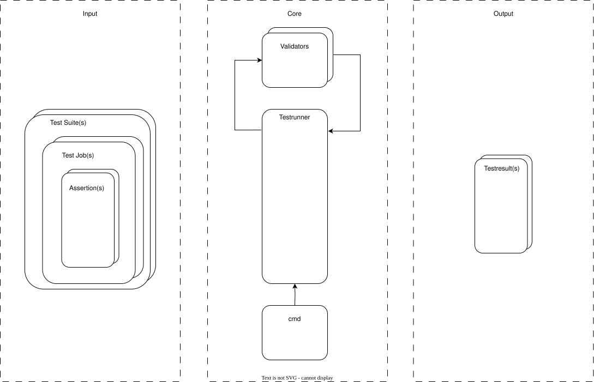

# Helmunittest Architecture

This page gives a short overview on how the Helm Unittest is being setup.
This can help identifying elements for resolving issues and creating new features.

## Overview



### Input
This section describes all input required to let helm-unittest do its work.
For each section there is a short summary on the reason for its existence.
Details on what the configure can be found in [Documents](./DOCUMENT.md)

#### Test Suite(s)
This input contains the definition of the test suite.
A helmunittest project can have multiple testsuites.
The testsuite is the starting point, the properties which you can set here are defined for the whole helmcharts, which you want to unittest.

| Features/Quirks | The feature | The quirk |
| ------ | ----- | ----- |
| When templates are defined, it filters only those templates | You can focus on only templates to be tests | templates that depends on other templates, need to be added to the list |
| When release and/or capabilities are defined, it overrides the behaviour of the chart itself | You can control the behaviour of the template rendering and have a predictable outcome | |
| When KubernetesProvider is used, it generates a Mock that can be used for e.g. Lookups | You can control the outcome of the rendering of dependend resources that are not part of the helm template | Only use the KubernetesProvider when you expect output, without the provider dependend resources return an empty object |

#### Test Job(s)
This input contains the definition of the test job.
Within the Testsuite it is possible (highly recommended) to have multiple testjobs.

| Features/Quirks | The feature | The quirk |
| ------ | ----- | ----- |
| For each testjob the complete helmchart will be reloaded | Isolation of the tests | Large helmchart project can take a bit longer to load |
| When values or sets is used, the values will be merged with the upper values | Similar approach as Helm itself | Unsetting specific values can be tricky |

#### Assertion(s)
This input contains the definition of the validation to be executed.
Within the Testjob it is possible (highly recommended) to have multiple assertions.

| Features/Quirks | The feature | The quirk |
| ------ | ----- | ----- |
| When the template is not used, the assertion will check all filtered templates | Maximum reuse of assertion | When filtering different resources, be aware the validation is correct for all types |
| When values or sets is used, the values will be merged with the upper values | Similar approach as Helm itself | Unsetting specific values can be tricky |

### Core
The core logic of the Helmunittest.

#### Testrunner
The testrunner is running al the logic in the following steps:

1. parsing the Input;
1. loads the helmchart;
1. filters only the templates identified;
1. renders the identified templates;
1. executes all validators;
1. generates output;

| Features/Quirks | The feature | The quirk |
| ------ | ----- | ----- |
| Where possible helm package is used to render the resources  | Be as closest to the helm behaviour | |

#### Validators
The validator is the implementation of a specific assertion.
Each assertion has it's own validator containing a basic Interface.
```go
type Validatable interface {
	Validate(context *ValidateContext) (bool, []string)
}
```

Each validator follows a similar pattern on evaluation (happy flow)
1. retrieve rendered resources (manifests)
1. validationSuccess is false
1. for each manifest
    1. retrieve values of set path
    1. check found values contains results
    1. foreach found value
        1. check singleValueValidation
        1. singleValueValidationSuccess is true
    1. determine validationSuccess
    1. validationSuccess is true
1. determine validationSuccess
1. validationSuccess is true

| Features/Quirks | The feature | The quirk |
| ------ | ----- | ----- |
| validation fails by default | To prevent false positive on validations |  |
| singleValueValidation also validates inverse checks | | |
| validations have a failfast option | When a singleValueValidation fails, it stops directly, which can speed-up the test | Not all failures will be shown | 

#### Assert on parsed JSON/YAML
Validators that embed `ParseOptions` (`validators/parse_options.go`) accept `parse` (`json` | `yaml`) and `innerPath`, so they can assert on serialized content held in a string field (e.g. a ConfigMap `config.json`). This changes the order of execution compared to the happy flow above: the value found at `path` is no longer what is validated. It is first parsed, then `innerPath` is resolved inside it, and the validator loops over the result of that.

It is designed as two optional fields rather than new assertion types, following the `decodeBase64` precedent (an optional field that transforms the actual value before comparison). This way every supported assertion inherits failure formatting, `not`, `documentSelector`, failfast and diff output without changes. When `parse` is omitted, the behaviour is unchanged: `resolveActuals` returns its input as-is. See [#924](https://github.com/helm-unittest/helm-unittest/pull/924) for the full design notes.

Order of execution for an assertion with `parse`:

1. **while loading the test suite** (before any rendering), the assertion options are checked:
    1. `parse`/`innerPath` on a validator that does not embed `ParseOptions` (e.g. `matchRegex`, `matchSnapshot`, the `Raw` assertions) is an error instead of being silently ignored;
    1. `parse` must be `json` or `yaml`, `innerPath` requires `parse`, and must not be blank or start with `.`;
1. retrieve rendered resources (manifests)
1. for each manifest
    1. retrieve values of set `path` (the *outer* values)
    1. `decodeBase64` the outer values when set (only `equal`/`notEqual`), so a Secret holding base64 encoded JSON/YAML can be parsed
    1. for each outer value
        1. the value must be a string, otherwise it fails
        1. parse it as `json` or `yaml`, and normalize numbers (integral → `int`, otherwise `float64`), so both formats produce the same types as an ordinary `path`
        1. resolve `innerPath` within the parsed content with the same JSONPath engine as `path`; a parsed array or scalar is wrapped under a synthetic root key first, so `innerPath: [0].title` also works. An empty `innerPath` returns the whole parsed document
    1. flatten all `innerPath` matches of all outer values into a single list of values
    1. when the list is empty, report `unknown path <path> innerPath <innerPath>` (or succeed for the inverse checks, e.g. `notExists`)
    1. foreach found value, continue with the normal singleValueValidation

| Features/Quirks | The feature | The quirk |
| ------ | ----- | ----- |
| Options are validated when the suite is loaded (`Assertion.UnmarshalYAML`) | A typo in `parse`/`innerPath`, or `parse` on an unsupported assertion, fails directly instead of making the assertion silently pass | It surfaces as a parse error of the test suite file, so none of the tests in that file run |
| `parse` must be set explicitly to `json` or `yaml`, it is never auto-detected | Malformed JSON is reported as an error | A YAML parser would accept malformed JSON (`{"port": 8080,}`) and turn unstructured text into a plain string, so auto-detection would hide real errors |
| Numbers are typed by value, not by how they are written: integral → `int`, otherwise `float64` | `parse: json`, `parse: yaml` and an ordinary `path` give the same type for the same value (`8080`, `1.0` and `1e3` are all `int`) | Large integers keep their exact value (`json.Decoder.UseNumber()`), and an integral number beyond the `int64` range stays `float64` instead of overflowing |
| Decoding happens before parsing, parsing before `innerPath` | `decodeBase64` + `parse` + `innerPath` can be combined on a single field | The order is fixed; it is not possible to parse first and decode a nested field afterwards |
| Parse errors (not a string, invalid JSON/YAML) are returned before the validation loop | A broken document is always reported | The error is not inverted by `not: true` or the `not*` assertions, so e.g. `notExists` on unparsable content fails instead of passing |
| `decodeBase64` only exists on `equal`/`notEqual` (and `matchRegex`, which does not support `parse`) | Secrets with base64 encoded JSON/YAML can be asserted with `equal` | Unlike `parse`, an unsupported `decodeBase64` (e.g. on `isType`) is silently ignored at runtime, because `mapstructure.Decode` ignores unknown keys; only the schema flags it |
| A failed base64 decode only fails that single value | Other outer values are still decoded, parsed and validated | A parse error, in contrast, stops the validation of the whole manifest |
| `innerPath` matches are flattened into one list | The existing per-value loop, `failfast` and `not` logic are reused unchanged; every match must satisfy the assertion | The value index in failure messages counts across the flattened `innerPath` matches, not the matches of `path` |
| Supported assertions are derived from embedding `ParseOptions` | The schema (`schema/helm-testsuite.json`), runtime and `schema_parse_fields_test.go` cannot silently drift apart | Adding `parse` support to a validator means embedding `ParseOptions`, calling `resolveActuals` after retrieving the `path` values, and updating the schema, the test list, the fixture chart `test/data/v3/parse-structured` and `DOCUMENT.md` |

#### Command
The Command containing the commandline parameters.

| Features/Quirks | The feature | The quirk |
| ------ | ----- | ----- |
| For debugging a deviating name is used | Explicit debugging of the plugin to gather as much information as possible | Helm is passing all parameters to the plugin, except for the debug flag |

#### Coverage
Opt-in (`--coverage`) per-template coverage. Every template is parsed via `text/template/parse` and instrumented with a `covprobe <idx>` call at each action/branch/loop node; each test job then renders a second time through the instrumented chart, and the runner reports which probes were hit.

| Features/Quirks | The feature | The quirk |
| ------ | ----- | ----- |
| `covprobe` records the hit and emits nothing | The coverage render's output is byte-for-byte what the template normally produces, so a helper consumed as data (`include ... \| fromJson`) still gets valid input | Adding a probe wrapper with a leading `{{-` trim (an `if`/`else` block prepended before the real action) can still eat the surrounding whitespace and corrupt that data; none of the current probes do this |
| Each job renders against its own deep copy of the shared instrumented chart | Helm's render mutates chart state (subchart pruning, metadata rewrite), so a chart shared across jobs would leak coverage between them | Doubles the render cost per job when `--coverage` is set |
| Report paths are rooted at the chart's actual directory, not its declared `Chart.yaml` name | Codecov/SonarQube/GitLab resolve `filename`/`SF:` paths relative to the working directory | The console table and report files show the directory the chart was loaded from, which can differ from what a chart's own docs call it |

### Output
The output is generating the results.
The testresults can be used to output to console or output to file.

#### Testresults
The testresults object containing all required information to have human readable or test automation based output. 
